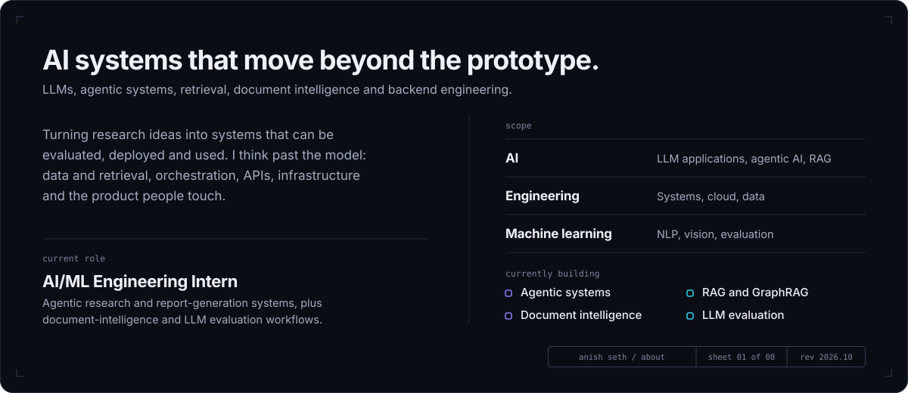
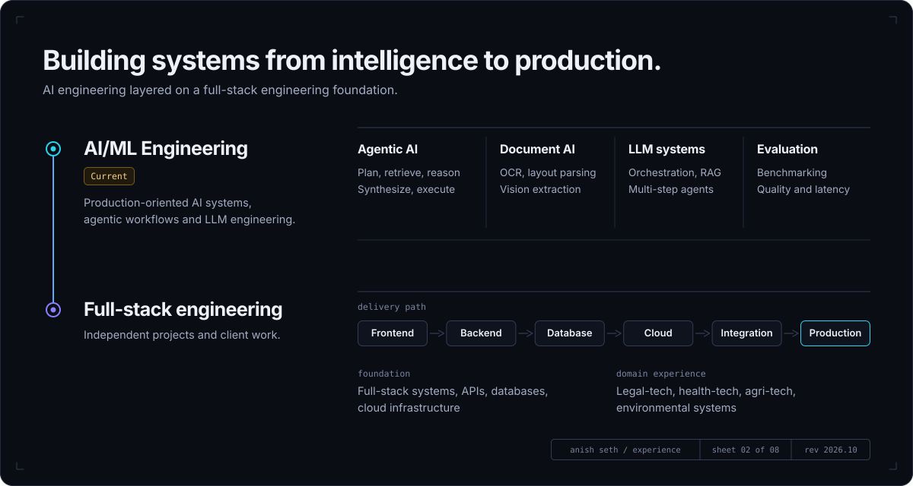
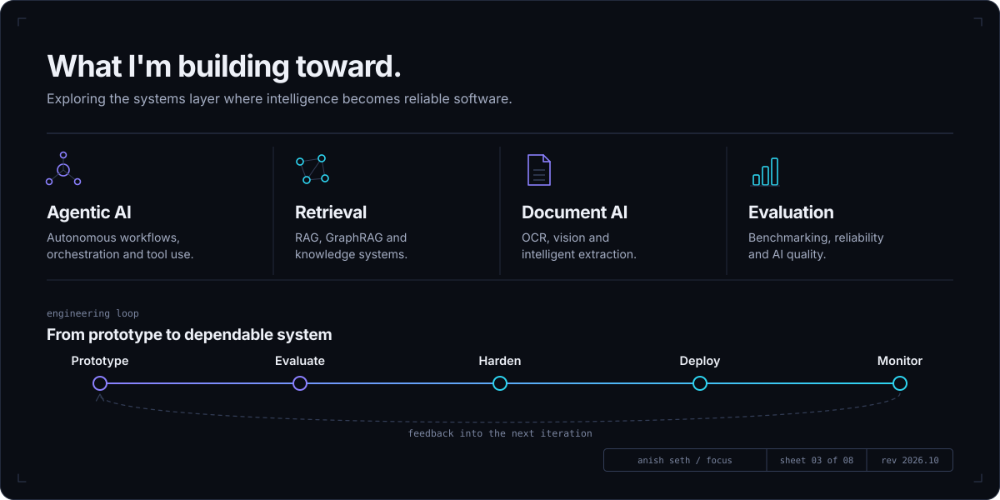
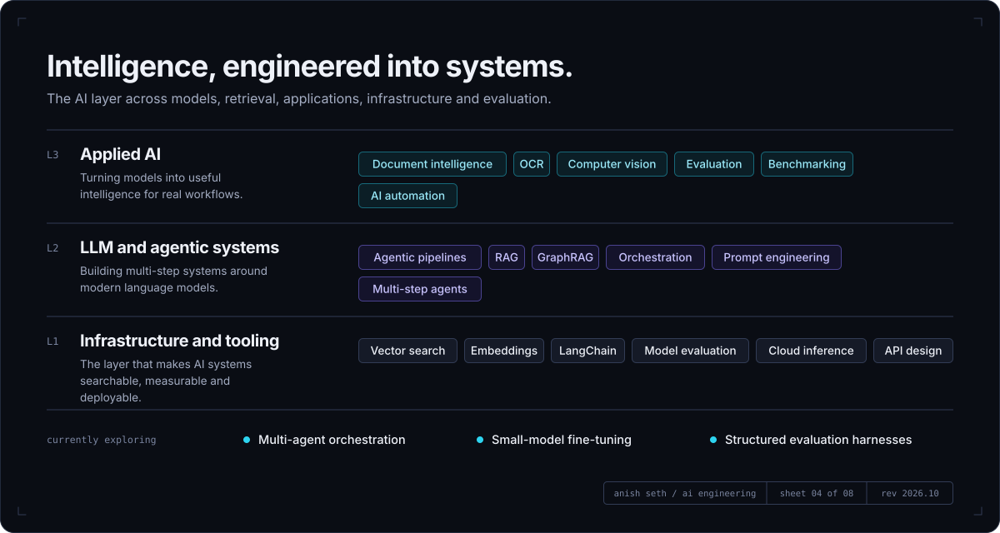
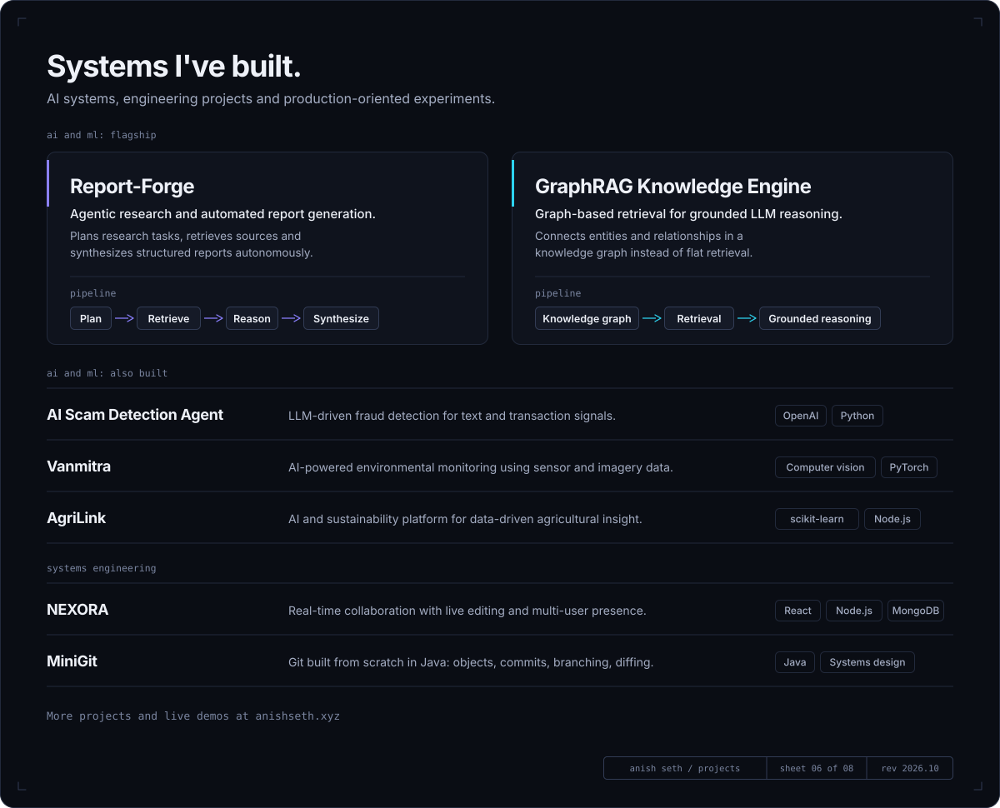
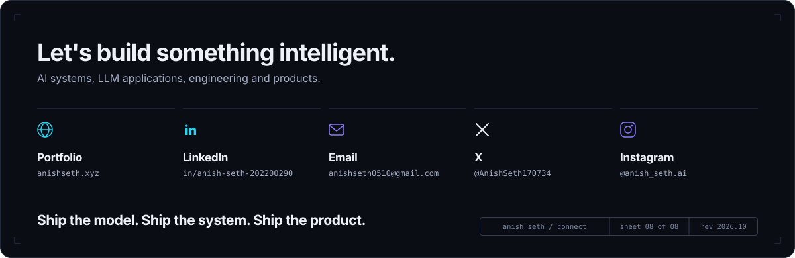

<!--
  Anish Seth · GitHub profile
  Design system "Schematic": profile visuals are generated SVGs in /assets,
  generated by scripts/build_assets.py (tokens and components in scripts/svgkit.py).
  Edit content in the script, not in the SVGs.
-->

 

## About

> I build AI systems that move beyond the prototype. My work sits at the intersection of LLMs, agentic systems, retrieval, document intelligence and backend engineering, turning research ideas into systems that can be evaluated, deployed and used.

## Experience

## Focus

## AI engineering

## Tech stack

## Projects

## Achievements and certifications

◈ More projects, live demos &amp; technical work on
<a href="https://www.anishseth.xyz"><b>anishseth.xyz</b></a>

## Activity

## Connect

<!-- ═══════════════════════════════════════════════ CONNECT ═══════════════════════════════════════════════ -->

 

Anish Seth — full profile summary

 

**Anish Seth** is an AI/ML engineer and full-stack developer based in Kolkata, India (GitHub: [Anish-2005](https://github.com/Anish-2005)). He builds LLM applications, agentic AI systems, retrieval pipelines (RAG and GraphRAG), document intelligence (OCR, layout parsing, vision-based extraction), and LLM evaluation workflows, backed by full-stack engineering across APIs, databases, cloud infrastructure and product interfaces. He currently works as an AI/ML Engineering Intern on agentic research and report-generation systems.

**Core skills:** Python, PyTorch, scikit-learn, LangChain, OpenAI / Gemini / Claude APIs, RAG, GraphRAG, vector search, embeddings, NLP, OCR, prompt engineering, LLM evaluation · Java, C++, C#, JavaScript, TypeScript · React, Next.js, Tailwind CSS, Node.js, Express, FastAPI, Django · PostgreSQL, MongoDB, Firebase, Supabase · AWS, Google Cloud, Cloud Run, Docker, Vercel · Git, Linux, n8n, Zapier.

**Selected projects:** Report-Forge (agentic research and automated report generation) · GraphRAG Knowledge Engine (graph-based retrieval for grounded LLM reasoning) · AI Scam Detection Agent (LLM-driven fraud detection) · [VanMitra](https://github.com/Anish-2005/VanMitra) (AI, remote sensing and WebGIS for forest-rights communities) · [AgriLink](https://github.com/Anish-2005/AgriLink) (AI and blockchain platform for agricultural waste) · [Financer](https://github.com/Anish-2005/Financer) (AI personal-finance platform with React, FastAPI and Firebase) · NEXORA (real-time collaborative document editing) · MiniGit (Git implementation from scratch in Java).

**Achievements and certifications:** Finalist at Smart India Hackathon 2024 and 2025 and Hack4Bengal 2025 · Google Student Ambassador · Campus Mantri · Outreach Head · Google AI/ML (AICTE virtual internship) · AWS Academy Cloud Architecting · Oracle Cloud Infrastructure AI Foundations Associate.

**Find Anish Seth online:** [Portfolio — anishseth.xyz](https://www.anishseth.xyz) · [LinkedIn](https://www.linkedin.com/in/anishseth) · [GitHub](https://github.com/Anish-2005) · [X](https://x.com/AnishSeth170734) · [Instagram](https://instagram.com/anish_seth.ai) · [Email](mailto:anishseth0510@gmail.com)

