<!--
  Anish Seth · GitHub profile
  Design system "Schematic": every section is an SVG sheet in /assets,
  generated by scripts/build_assets.py (tokens and components in scripts/svgkit.py).
  Edit content in the script, not in the SVGs.
-->

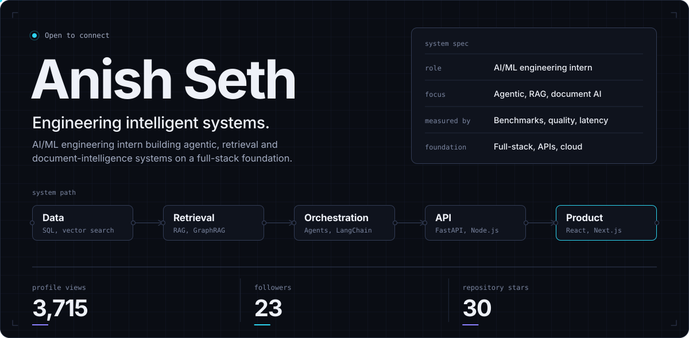

 

<a href="#about">About</a> &nbsp;·&nbsp;
<a href="#experience">Experience</a> &nbsp;·&nbsp;
<a href="#focus">Focus</a> &nbsp;·&nbsp;
<a href="#ai-engineering">AI engineering</a> &nbsp;·&nbsp;
<a href="#tech-stack">Tech stack</a> &nbsp;·&nbsp;
<a href="#projects">Projects</a> &nbsp;·&nbsp;
<a href="#achievements">Achievements</a> &nbsp;·&nbsp;
<a href="#activity">Activity</a> &nbsp;·&nbsp;
<a href="#connect">Connect</a>

 

## About

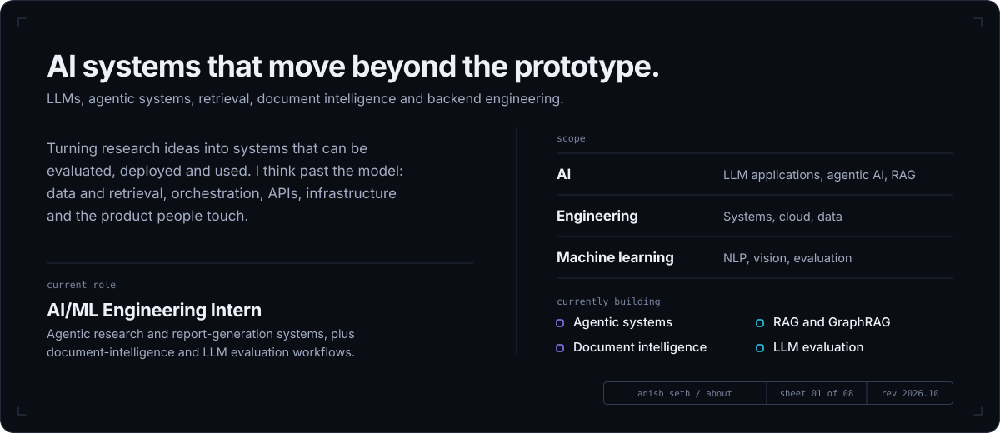

> I build AI systems that move beyond the prototype. My work sits at the intersection of LLMs, agentic systems, retrieval, document intelligence and backend engineering, turning research ideas into systems that can be evaluated, deployed and used.

## Experience

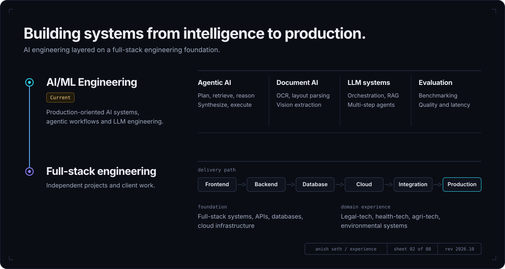

## Focus

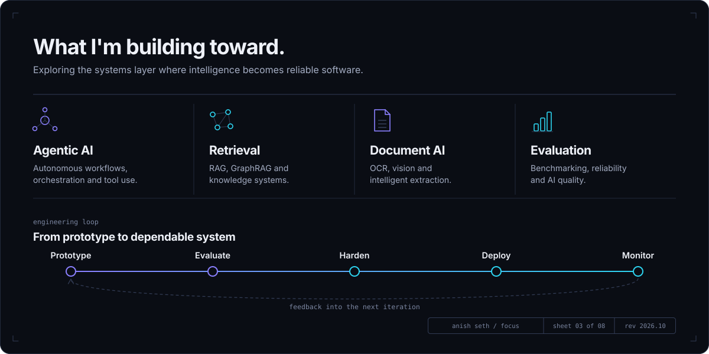

## AI engineering

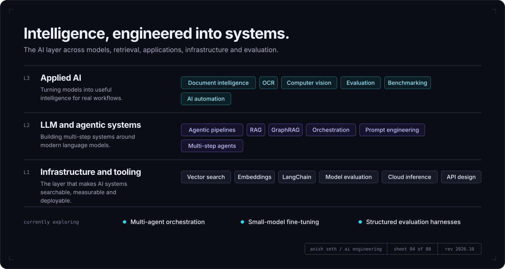

## Tech stack

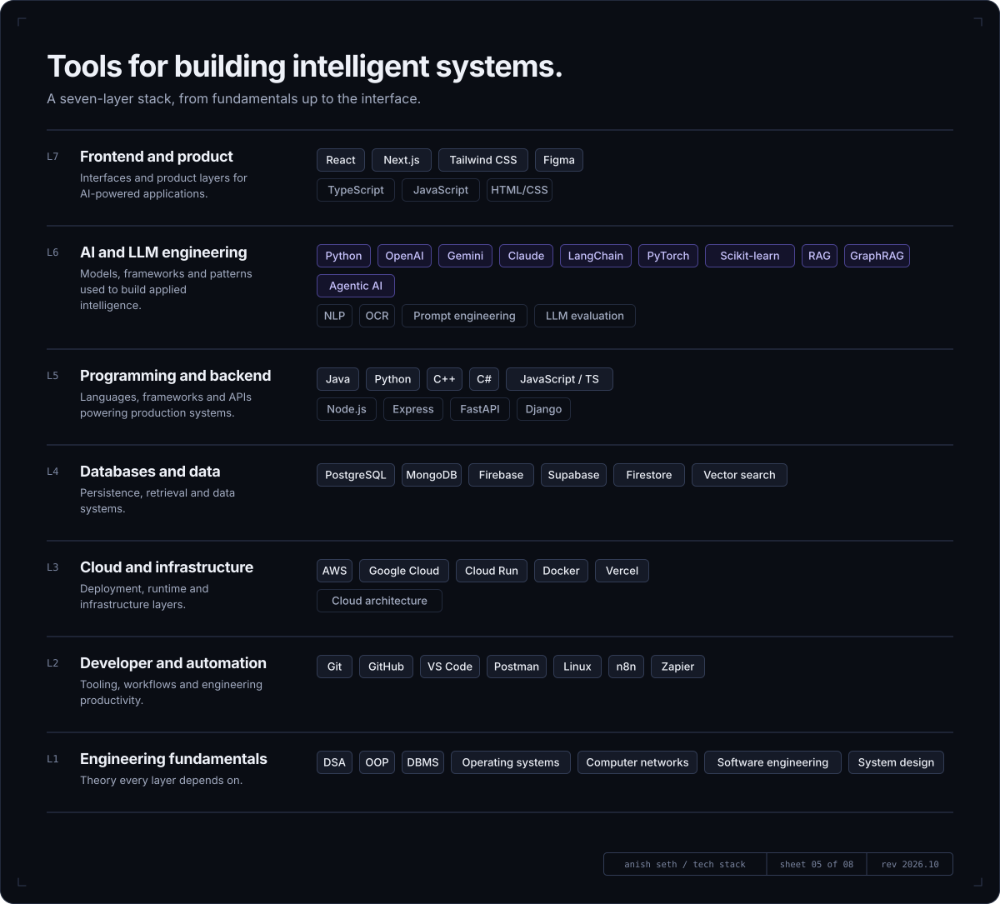

## Projects

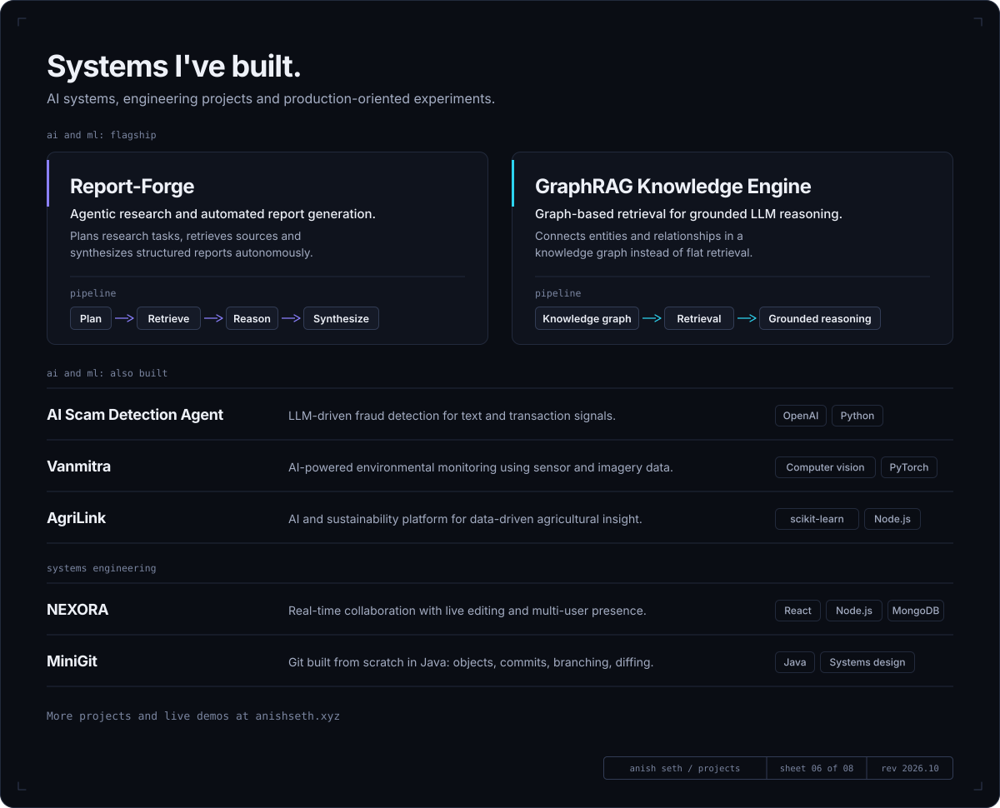

More projects and live demos at <a href="https://www.anishseth.xyz"><b>anishseth.xyz</b></a>

## Achievements and certifications

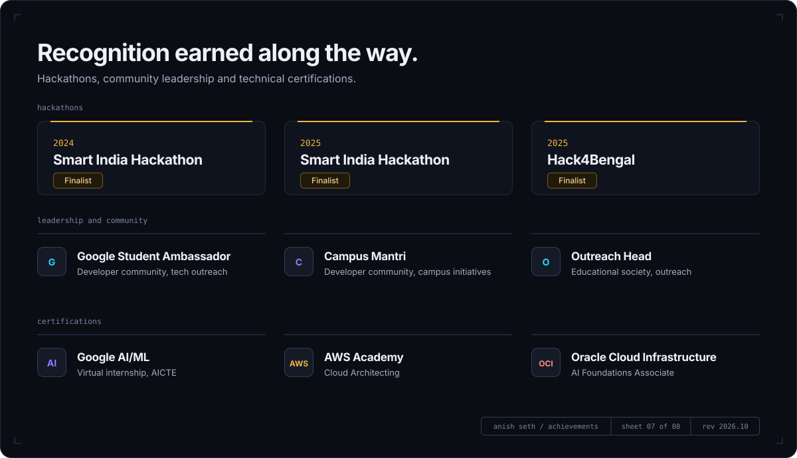

## Activity


## Connect

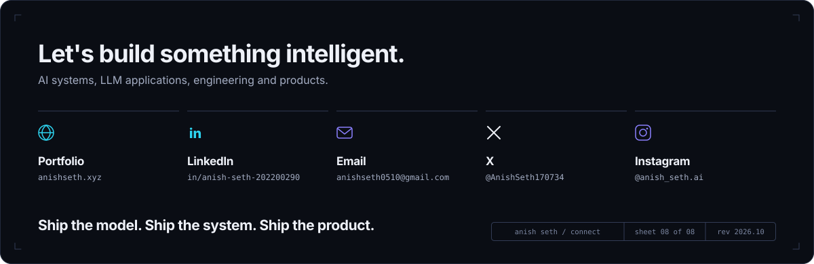

<a href="https://www.anishseth.xyz">Portfolio</a> &nbsp;·&nbsp;
<a href="https://www.linkedin.com/in/anish-seth-202200290/">LinkedIn</a> &nbsp;·&nbsp;
<a href="mailto:anishseth0510@gmail.com">Email</a> &nbsp;·&nbsp;
<a href="https://x.com/AnishSeth170734">X</a> &nbsp;·&nbsp;
<a href="https://instagram.com/anish_seth.ai">Instagram</a>

