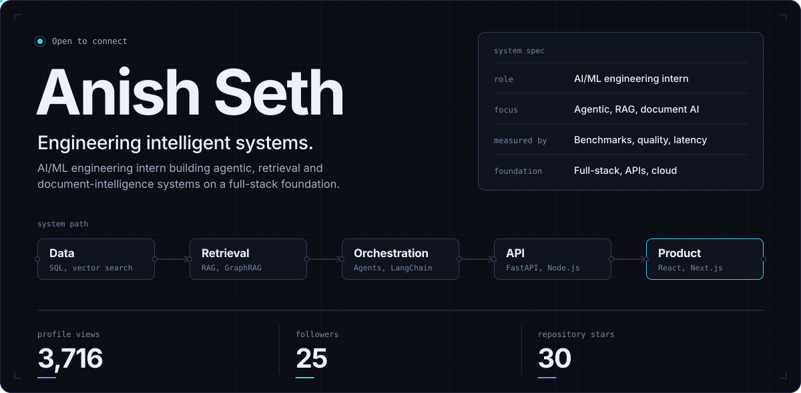
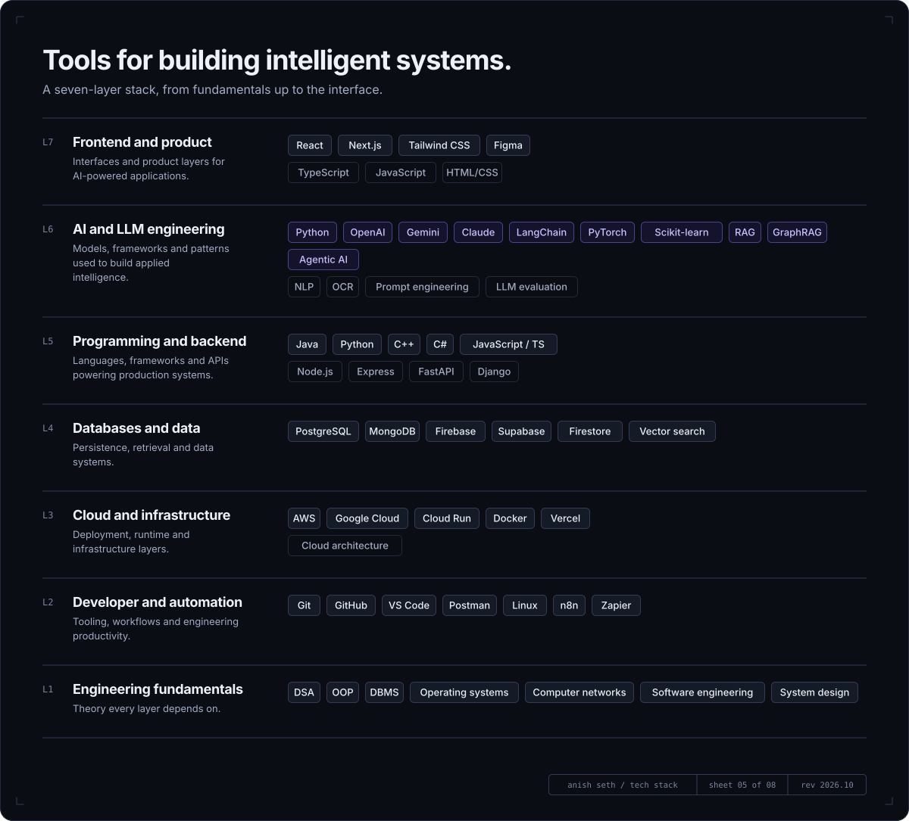
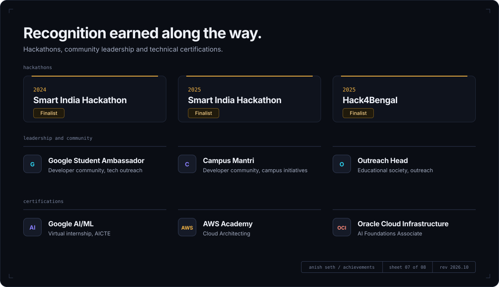

<!-- ═══════════════════════════════════════════════════════════════════════════════ -->
<!-- ANISH SETH — GITHUB PROFILE README · Design System: "Aurora"                  -->
<!-- Palette → Violet #6C63FF · Cyan #00D9FF · Ink #0A0E1A                     -->
<!-- Header → Repository-hosted SVG · Navigation → Native GitHub anchors          -->
<!-- ═══════════════════════════════════════════════════════════════════════════════ -->

<b>Anish Seth</b> · AI/ML Engineer &amp; Full-Stack Developer · Kolkata, India 
<a href="#about">About</a> ·
<a href="#experience">Experience</a> ·
<a href="#focus">Focus</a> ·
<a href="#ai-engineering">AI Engineering</a> ·
<a href="#tech-stack">Tech Stack</a> ·
<a href="#projects">Projects</a> ·
<a href="#achievements">Achievements</a> ·
<a href="#connect">Connect</a>

 

---
<!-- ═══════════════════════════════════════════════════════════════════════ -->
<!-- 🧠 ABOUT -->
<!-- ═══════════════════════════════════════════════════════════════════════ -->

## 🧠 ABOUT ME

 

> **I build AI systems that move beyond the prototype.**
>
> My work sits at the intersection of **LLMs, agentic systems, retrieval, document intelligence, and backend engineering** — turning research ideas into systems that can actually be evaluated, deployed, and used.

I'm currently working as an **AI/ML Engineering Intern**, building agentic research and report-generation systems alongside document-intelligence and LLM evaluation workflows.

My foundation is in **full-stack engineering**, which shapes how I approach AI: I think beyond the model itself — from **data and retrieval → orchestration → APIs → infrastructure → user-facing products**.

 

`Agentic Systems` · `RAG / GraphRAG` · `Document Intelligence` · `LLM Evaluation`

<!-- ═══════════════════════════════════════════════════════════════════════ -->
<!-- 💼 EXPERIENCE -->
<!-- ═══════════════════════════════════════════════════════════════════════ -->

## 💼 EXPERIENCE

 

> **I build AI systems with a software-engineering mindset.**
>
> My experience spans **agentic AI, LLM systems, document intelligence, evaluation, backend engineering, and cloud deployment** — backed by a full-stack foundation that lets me work across the entire system rather than only the model layer.
<!-- ═══════════════════════════════════════════════════════════════════════ -->
<!-- 🎯 CURRENT FOCUS -->
<!-- ═══════════════════════════════════════════════════════════════════════ -->

## 🎯 CURRENT FOCUS

 

> **The goal isn't just to make AI work. It's to make AI systems reliable enough to ship.**

<!-- ═══════════════════════════════════════════════════════════════════════ -->
<!-- 🤖 AI ENGINEERING -->
<!-- ═══════════════════════════════════════════════════════════════════════ -->

## 🤖&nbsp; AI ENGINEERING

 

> **Engineering the layer between models and real-world systems.**
>
> I work across **LLM applications, agentic workflows, retrieval, document intelligence, evaluation, and AI infrastructure** — with an emphasis on systems that can be measured, integrated, and deployed.

<!-- ═══════════════════════════════════════════════════════════════════════ -->
<!-- 🛠️ TECH STACK -->
<!-- ═══════════════════════════════════════════════════════════════════════ -->

## 🛠️ TECH STACK

 

> **A full-stack foundation for AI engineering.**
>
> I work across **models → retrieval → orchestration → APIs → data → infrastructure → product**, using the stack required to take an intelligent system from idea to deployment.
<!-- ═══════════════════════════════════════════════════════════════════════ -->
<!-- 🚀 PROJECTS -->
<!-- ═══════════════════════════════════════════════════════════════════════ -->

## 🚀&nbsp; FEATURED PROJECTS

 

<a href="https://github.com/Anish-2005?tab=repositories&q=report-forge">Report-Forge</a> ·
<a href="https://github.com/Anish-2005?tab=repositories&q=graphrag">GraphRAG Knowledge Engine</a> ·
<a href="https://github.com/Anish-2005?tab=repositories&q=scam">AI Scam Detection Agent</a> ·
<a href="https://github.com/Anish-2005/VanMitra">VanMitra</a> ·
<a href="https://github.com/Anish-2005/AgriLink">AgriLink</a> ·
<a href="https://github.com/Anish-2005?tab=repositories&q=nexora">NEXORA</a> ·
<a href="https://github.com/Anish-2005?tab=repositories&q=minigit">MiniGit</a>

 

◈ More projects, live demos &amp; technical work on
<a href="https://www.anishseth.xyz"><b>anishseth.xyz</b></a>

<!-- ═══════════════════════════════════════════════════════════════════════ -->
<!-- 🏆 ACHIEVEMENTS -->
<!-- ═══════════════════════════════════════════════════════════════════════ -->

## 🏆&nbsp; ACHIEVEMENTS & CERTIFICATIONS

<!-- ═══════════════════════════════════════════════ ACTIVITY ═══════════════════════════════════════════════ -->

## 📊&nbsp; GITHUB ACTIVITY

<!-- ═══════════════════════════════════════════════ CONNECT ═══════════════════════════════════════════════ -->

<a href="https://www.anishseth.xyz"><b>Portfolio</b></a> ·
<a href="https://www.linkedin.com/in/anishseth"><b>LinkedIn</b></a> ·
<a href="mailto:anishseth0510@gmail.com"><b>Email</b></a> ·
<a href="https://x.com/AnishSeth170734"><b>X</b></a> ·
<a href="https://instagram.com/anish_seth.ai"><b>Instagram</b></a>

 

Anish Seth — full profile summary

 

**Anish Seth** is an AI/ML engineer and full-stack developer based in Kolkata, India (GitHub: [Anish-2005](https://github.com/Anish-2005)). He builds LLM applications, agentic AI systems, retrieval pipelines (RAG and GraphRAG), document intelligence (OCR, layout parsing, vision-based extraction), and LLM evaluation workflows, backed by full-stack engineering across APIs, databases, cloud infrastructure and product interfaces. He currently works as an AI/ML Engineering Intern on agentic research and report-generation systems.

**Core skills:** Python, PyTorch, scikit-learn, LangChain, OpenAI / Gemini / Claude APIs, RAG, GraphRAG, vector search, embeddings, NLP, OCR, prompt engineering, LLM evaluation · Java, C++, C#, JavaScript, TypeScript · React, Next.js, Tailwind CSS, Node.js, Express, FastAPI, Django · PostgreSQL, MongoDB, Firebase, Supabase · AWS, Google Cloud, Cloud Run, Docker, Vercel · Git, Linux, n8n, Zapier.

**Selected projects:** Report-Forge (agentic research and automated report generation) · GraphRAG Knowledge Engine (graph-based retrieval for grounded LLM reasoning) · AI Scam Detection Agent (LLM-driven fraud detection) · [VanMitra](https://github.com/Anish-2005/VanMitra) (AI, remote sensing and WebGIS for forest-rights communities) · [AgriLink](https://github.com/Anish-2005/AgriLink) (AI and blockchain platform for agricultural waste) · [Financer](https://github.com/Anish-2005/Financer) (AI personal-finance platform with React, FastAPI and Firebase) · NEXORA (real-time collaborative document editing) · MiniGit (Git implementation from scratch in Java).

**Achievements and certifications:** Finalist at Smart India Hackathon 2024 and 2025 and Hack4Bengal 2025 · Google Student Ambassador · Campus Mantri · Outreach Head · Google AI/ML (AICTE virtual internship) · AWS Academy Cloud Architecting · Oracle Cloud Infrastructure AI Foundations Associate.

**Find Anish Seth online:** [Portfolio — anishseth.xyz](https://www.anishseth.xyz) · [LinkedIn](https://www.linkedin.com/in/anishseth) · [GitHub](https://github.com/Anish-2005) · [X](https://x.com/AnishSeth170734) · [Instagram](https://instagram.com/anish_seth.ai) · [Email](mailto:anishseth0510@gmail.com)

